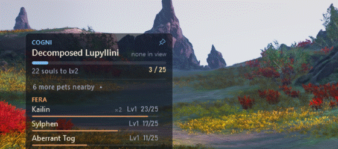

# AION 2 Pet Tracker

A small overlay for **AION 2 Global (EU / NA)**. It shows the pet you're farming, how many souls it needs for its
next level, and which other monsters around you drop pet souls.



## Install

1. **Install [Npcap](https://npcap.com/#download)** with its default options. It's the free driver the tracker uses
   to see the game's traffic. The installer checks for it and helps you get it.
2. **Download `AION2PetTracker-Setup-v….exe`** from the
   [latest release](https://github.com/ysaatci/aion2-pet-tracker/releases/latest) and run it.
   - If Windows shows "Windows protected your PC", click **More info → Run anyway**. This appears once, for the
     installer only (see [FAQ](#faq)).
   - No administrator rights needed. It adds a Start menu and desktop shortcut.
3. **Start the tracker before logging in to your character.** The game sends your pet collection once, at login.
   After that the tracker remembers it.

Prefer no installation? Download `AION2PetTracker.exe` from the same release instead. It's a single file you can
run from anywhere.

## Using it

The pet you're farming sits on top: its genus, a progress bar, and the souls left to its next level (5 to unlock,
then 25, then 75). It follows your latest soul drop automatically.

Below it, **"N more pets nearby ▾"** opens a list of the other monsters in view that drop pet souls, grouped by
genus (Cogni, Fera, Natura, Varian, Special).

In game, hold **Alt** to get the mouse cursor. Then:

| To | Do |
|---|---|
| Farm a different pet | Open the nearby list and click the pet |
| Go back to following your latest soul drop | Click the pin icon next to the pet's genus |
| Remove a pet from the list until its mobs show up again | Hover its row and click × |
| Make the overlay bigger or smaller | Hover the overlay and click − or + |
| Hide the overlay | Hover it and click ×, or press **Ctrl+Shift+P** (press it again to bring it back) |
| Move the overlay | Drag it |

Clicking the overlay never takes focus away from the game. More options (hotkeys, updates) are in the tray icon's
menu: the gold **A** next to the clock.

## FAQ

**Can I get banned for this?**
The tracker only *listens* to your own network traffic, the same way popular AION 2 DPS meters do. It never reads
or changes game memory, injects anything, or sends anything to the game. Still, no third-party tool is approved by
NCSOFT, so use it at your own risk.

**Why does Windows warn me?**
Small free tools like this one (and most game meters) aren't signed with a paid certificate, so Windows SmartScreen
asks once before running the download. A few PCs, mostly brand-new ones, have *Smart App Control* turned on, which
blocks every unsigned program, this tracker included.

**How do updates work?**
The installed tracker checks GitHub for a new version every couple of hours, downloads it in the background, and
installs it when you're not playing (or after 10 minutes without a fight). It then restarts by itself. The tray
notice lets you install right away. The portable exe only tells you a new version is out.

**My pets show "Log in again to load your pets".**
The tracker hasn't seen a login yet. Go to character select and log back in with the tracker running.

**A pet I'm farming isn't listed.**
The overlay only lists monsters currently in view. About 40 pets come only from chests, shops or events, so no
monster drops them. If a monster drops a soul for a pet the tracker didn't know about, it learns that from your kills.

**Where are my settings? How do I uninstall?**
Settings and pet progress are in `%APPDATA%\AION2PetTracker`. Uninstall from *Settings → Apps* (it asks whether to
delete your settings too), or just delete the portable exe.

**It also contains a DPS meter?**
Yes. The tracker is built on an open-source DPS meter, which stays hidden. **Ctrl+Shift+D** opens it, and the
tray menu's *Settings → Show the DPS meter* keeps it on.

## Privacy

There are no accounts, telemetry, analytics or ads. Everything stays on your PC: settings, pet progress and logs
(kept 14 days) in `%APPDATA%\AION2PetTracker`, and game data tables in `%LOCALAPPDATA%\AION2PetTracker`.

- **What it reads:** only the traffic between your PC and the AION 2 game server. It shows your own pet progress
  and the monsters near you. Other players' names and damage are never saved unless you turn the DPS meter on,
  which keeps a local fight history.
- **What it sends:** nothing to the game. Its only network requests are:
  - **GitHub** (`api.github.com`), every 2 hours, to check for a new version. You can turn this off in Settings →
    "Check GitHub for new versions". GitHub sees your IP address and the app version.
  - Only while the DPS meter's windows are open: skill icons from NCSOFT's game-data CDN (`assets.playnccdn.com`)
    and boss portraits from MetaBot.GG (`metabot.gg`). Settings → "Download skill icons and boss portraits" turns
    these off.

## Credits and licence

- Built on [AION2 DPS Meter](https://github.com/cyberbadger6969/aion2-dps-meter) by cyberbadger6969, whose capture and
  protocol work does the heavy lifting.
- Game data tables (skill, NPC and dungeon names) come from [A2Tools DPS Meter](https://github.com/taengu/A2Tools-DPS-Meter)
  and [AIon2-Dps-Meter](https://github.com/Kuroukihime/AIon2-Dps-Meter). Both are GPL-3.0.
- Pet data (genus, souls to unlock, which monsters drop each soul) comes from
  [MetaBot.GG](https://metabot.gg/en/aion-2/mounts).
- AION 2 and its game data © NCSOFT. This project is not affiliated with NCSOFT.

Licensed under the [GNU GPL v3](LICENSE).

## For developers

Requires the .NET 10 SDK on Windows. `build-release.ps1` also needs Inno Setup 6.3+ to build the installer.

```
dotnet test tests/AionMeter.Tests
dotnet build src/AionMeter.App -c Release
powershell -File build-release.ps1          # dist/: installer, portable exe, zip, source
```

| Project | What it does |
|---|---|
| `AionMeter.Core` | Npcap capture, TCP reassembly, packet decoding (from the DPS meter) |
| `PetTracker.Core` | Pet catalog, progress, nearby monsters, focus pet |
| `AionMeter.App` | The WPF overlay and tray app |
| `AionMeter.Cli` | Developer tool: record and replay captures (`pets <file.pcap>` replays one through the tracker) |

To release, bump `<Version>` in `src/AionMeter.App/AionMeter.App.csproj` and push a `vX.Y.Z` tag. The release
workflow builds everything and drafts the release; publishing it rolls the update out to installed copies. The pet catalog is rebuilt with
`tools/build-pet-catalog.ps1`.
