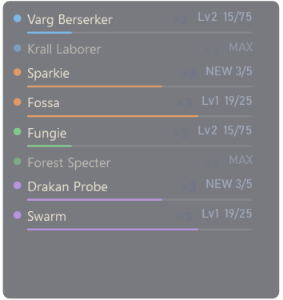

# AION 2 Pet Tracker

A small overlay for **AION 2 Global (EU / NA)** that shows which monsters around you drop **pet souls**, and how
far each of those pets is from its next level.



- **Nearby only**: the monsters in view that drop a pet's soul, with a dot coloured by genus
  (Cogni, Fera, Natura, Varian, Special).
- **Your progress**: level and souls toward the next level (5 to unlock, then 25, then 75), updated as each soul
  drops.
- A pet whose last mob you killed stays listed (faded) for 5 minutes. **×** removes a pet until its mobs show up
  again.
- Sizes S / M / L / XL, background opacity and number of rows (right-click). **Ctrl+Shift+P** shows or hides it.

## Download

Get **AION2PetTracker.exe** from [Releases](https://github.com/ysaatci/aion2-pet-tracker/releases/latest).
It's a single file: no installation and no .NET needed. You do need [Npcap](https://npcap.com/#download),
installed with its default options. See [INSTALL.txt](INSTALL.txt) for details.

Start the tracker **before logging in to your character**: the game sends your pet collection once, at login.
The tracker saves it, so later starts mid-session continue from there.

## How it works

The tracker passively reads the game's own network traffic through Npcap. It doesn't read game memory, inject
anything, or send anything to the game. It only shows your own character's data.

| Packet | When | What |
|---|---|---|
| `00 90` | login | owned pets and their levels, souls per pet |
| `0d 90` | ~0.35 s after a kill | a soul dropped: pet id, souls gained |
| `41 36` | a monster comes into view | NPC code and position |

The packets are documented in [docs/protocol-pets.md](docs/protocol-pets.md).

The pet catalog `data/pets.json` (207 pets: genus, souls to unlock, NPCs that drop each soul) is built by
`tools/build-pet-catalog.ps1` from [MetaBot.GG](https://metabot.gg/en/aion-2/mounts), which reads the Global
client's data. The tracker also learns NPC → pet links from your own kills.

## Build

.NET 10 SDK on Windows.

```
dotnet build src/AionMeter.App -c Release
dotnet run --project src/AionMeter.Cli -- pets captures/some-recording.pcap   # replay a recording through the tracker
powershell -File build-release.ps1                                             # dist/AION2PetTracker.exe
```

Projects: `AionMeter.Core` (capture, protocol), `PetTracker.Core` (catalog, progress, nearby pets), `AionMeter.App`
(WPF overlay), `AionMeter.Cli` (developer tool), `AionMeter.Tests`.

## Credits and licence

- Built on [AION2 DPS Meter](https://github.com/cyberbadger6969/aion2-dps-meter) by cyberbadger6969 (GPL-3.0), whose
  capture and protocol work does the heavy lifting. Its game data tables come from
  [A2Tools](https://github.com/taengu/A2Tools-DPS-Meter) and [AIon2-Dps-Meter](https://github.com/Kuroukihime/AIon2-Dps-Meter).
- Pet data: [MetaBot.GG](https://metabot.gg/en/aion-2/mounts).
- AION 2 game data © NCSOFT. This project is not affiliated with NCSOFT.

Third-party tools may be against the game's terms of service. Use at your own risk.

Licensed under GPL-3.0, see [LICENSE](LICENSE).
